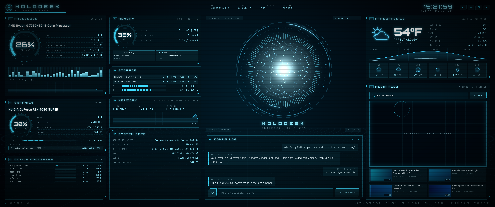

# HOLODESK

A fullscreen holographic HUD for Windows. It shows live hardware telemetry and local weather, plays YouTube videos, and has a voice assistant that runs on Claude, ChatGPT, or a free model on your own PC through Ollama.

Laid out for 3440×1440 ultrawide monitors and scaled to fit any other resolution.



## Features

**Hardware telemetry**
- CPU: model, per-thread load, clock, temperature, cache, 60-second load history
- GPU: load, temperature, VRAM, core clock, fan, power draw
- Memory modules, pagefile, drives and volume usage, network throughput
- Motherboard, BIOS, OS build, displays, and the busiest processes

**Weather.** Current conditions, a 24-hour temperature and rain curve, and a 6-day forecast from [Open-Meteo](https://open-meteo.com). Location comes from your IP address, or from a city you set. No API key needed.

**Media.** Search YouTube and play results in an embedded player. Known ad and tracking domains are blocked at the network level. Most ads are filtered, but YouTube can still serve some.

**Assistant**
- Talk or type to Claude (Anthropic) or ChatGPT (OpenAI) using your own API key, or to a free local model through Ollama or LM Studio. Any OpenAI-compatible server works, including Groq and OpenRouter.
- Each request includes your PC's live stats and the weather, so you can ask "how hot is my GPU?" or "do I need a jacket tomorrow?"
- Say "play lo-fi beats" to search and play a video.
- The particle sphere in the center reacts to the assistant's voice, and the blue theme shifts as it listens, thinks and speaks.
- Any playing video pauses while the microphone is open.

**Voice engines**
- **Windows:** free and offline. Uses built-in Windows speech recognition and the voices installed on your PC.
- **OpenAI:** Whisper transcription and OpenAI voices. More accurate and natural, and the sphere follows the real waveform. Requires an OpenAI key.

## Install

Download `HOLODESK-Setup-<version>.exe` from the latest CI run's artifacts and run it.

- No administrator rights are needed. It installs to `%LOCALAPPDATA%\Programs\HOLODESK` and adds Start menu and desktop shortcuts.
- The installer is unsigned, so Windows SmartScreen may warn on first run. Choose **More info → Run anyway**.
- Settings and encrypted API keys are stored in `%APPDATA%\HOLODESK`. Uninstalling asks whether to remove them.

## First run

The Uplink screen opens on first launch.

1. Paste an API key from [console.anthropic.com](https://console.anthropic.com/settings/keys) or [platform.openai.com](https://platform.openai.com/api-keys) and press **Link**. HOLODESK checks the key, then lists the models it can use.
2. API usage is billed by the provider. A Claude Pro or ChatGPT Plus subscription does not include API access.
3. For a free assistant that runs offline, install [Ollama](https://ollama.com/download), run `ollama pull llama3.2`, then press **Link** on the **Local** card with the Ollama preset. No key needed. To use a `.gguf` file you already have, create a file named `Modelfile` containing `FROM ./your-model.gguf` and run `ollama create mymodel -f Modelfile`.
4. Keys are encrypted with Windows DPAPI and only sent to the provider they belong to.

To use HOLODESK without AI, choose **Continue without AI**. The Uplink screen can be reopened at any time with the gear icon or `Ctrl+,`.

## Controls

| Key | Action |
| --- | --- |
| `Ctrl+Space`, or click the sphere | Talk |
| `Esc` | Stop listening, cancel a request, or stop speaking |
| `Ctrl+L` | Focus the message box |
| `Ctrl+K` | Focus YouTube search |
| `Ctrl+,` | Uplink and settings |
| `F11` | Toggle fullscreen |
| `Ctrl+Q` | Quit |

## Settings

| Setting | Options |
| --- | --- |
| Active AI | Claude, ChatGPT or Local (Ollama, LM Studio, Groq, OpenRouter, custom), plus model per provider |
| Voice engine | Windows (offline) or OpenAI |
| Speak replies | On / Off |
| Visual quality | High, Balanced, Low (for laptops) |
| Clock | 24-hour / 12-hour |
| Start with Windows | On / Off |
| Units | Auto, °F/mph, °C/km/h |
| Weather location | Auto-detect or a city name |

## Better sensor readings

Windows does not expose CPU temperature to regular programs on most hardware, and AMD and Intel GPUs report little through standard APIs. HOLODESK reads extra sensors when they are available:

- **NVIDIA GPUs:** read automatically through `nvidia-smi`, which ships with the driver.
- **Everything else:** run [LibreHardwareMonitor](https://github.com/LibreHardwareMonitor/LibreHardwareMonitor) and enable **Options → Remote Web Server** (port 8085). HOLODESK detects it automatically and uses it for CPU temperature and AMD/Intel GPU stats.

## Resource use

HOLODESK is built to stay light while it runs all day:

- The sphere renders on the GPU with WebGL. A Canvas 2D fallback is used if WebGL is unavailable.
- Decorative rings are drawn once and rotated by the compositor.
- Each hardware metric is polled at a rate that matches how fast it changes, through one shared PowerShell session instead of a new process per query.
- Telemetry stops while the window is minimized or hidden, or the screen is locked.
- The Windows speech recognizer and audio devices are released when idle.

## Development

Requires Node.js 22+ on Windows.

```
npm install
npm start          # run from source
npm test           # unit tests
npm run test:e2e   # end-to-end tests against the real app
npm run build      # dist/HOLODESK-Setup-<version>.exe (needs NSIS: winget install NSIS.NSIS)
```

CI runs on every push. It runs both test suites, builds the installer, installs it silently, smoke-tests the installed app, and uploads the installer as an artifact.

See [CLAUDE.md](CLAUDE.md) for the architecture and conventions.

## License

MIT. Fonts (Orbitron, Rajdhani, Share Tech Mono) are under the SIL Open Font License; see `src/renderer/fonts/OFL.txt`.
